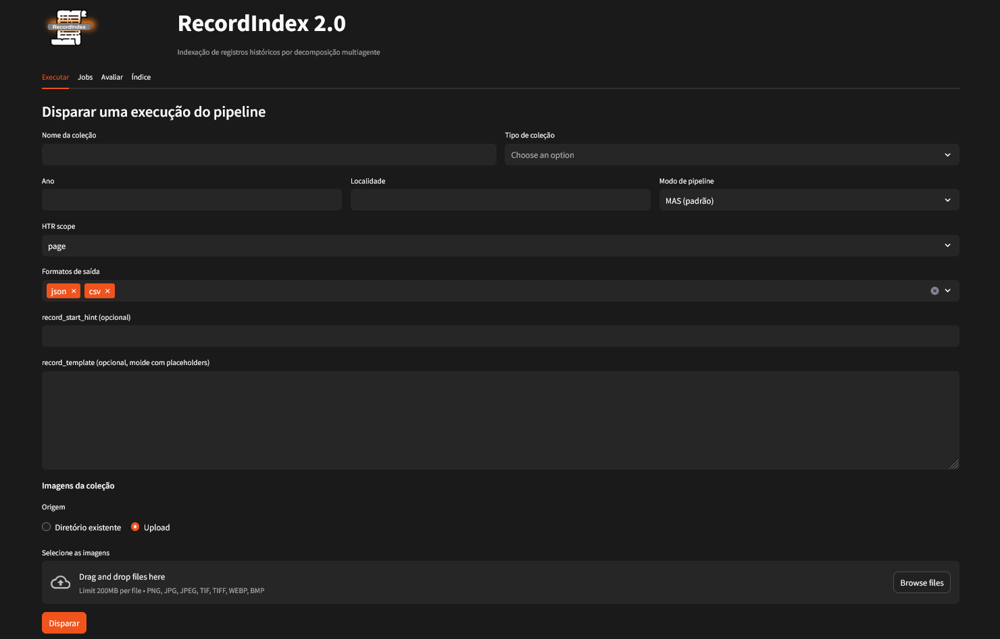
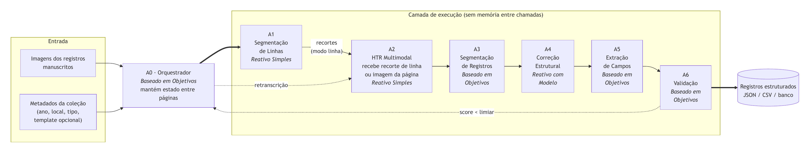
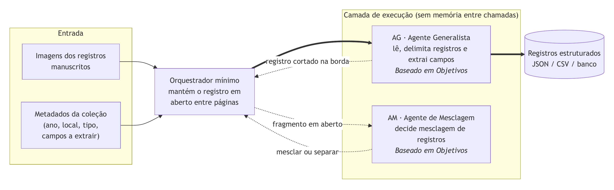

<div align="center">

<p></p>


</div>

# RecordIndex 2.0

Sistema de transcrição e indexação automatizada de registros genealógicos manuscritos (registros civis e eclesiásticos), baseado em modelos de linguagem multimodais. A partir das imagens digitalizadas de um livro de registros, o sistema transcreve o texto, delimita cada assento e extrai os campos de interesse (por exemplo nome, pai, mãe e data), gerando um índice consultável.

Trabalho de Conclusão de Curso em Ciência da Computação na Universidade Presbiteriana Mackenzie, continuação do RecordIndex 1.0, desenvolvido na iniciação tecnológica.

> **English summary.** RecordIndex 2.0 transcribes and indexes handwritten genealogical records using multimodal LLMs, either through a seven-agent pipeline or a single generalist agent. The full description and results are in the (Portuguese) report in [`docs/`](docs/RecordIndex2_relatorio_TCC2.pdf). The ground truth used in the experiments is in [`data/ground_truth/`](data/ground_truth/).



## Documentação

O relatório do TCC descreve o problema, a arquitetura, o protocolo de avaliação e os resultados:
[`docs/RecordIndex2_relatorio_TCC2.pdf`](docs/RecordIndex2_relatorio_TCC2.pdf).

## Como funciona

O sistema tem dois modos de pipeline, selecionáveis na interface:

- **Multiagente (A0 a A6):** um orquestrador (A0) coordena agentes especializados em segmentação de linhas (A1), transcrição (A2), delimitação de registros (A3), correção com base em um template do assento (A4), extração de campos via structured output (A5) e validação (A6). A transcrição pode ser feita linha a linha ou com a página inteira.
- **Generalista:** um único agente (AG) recebe a página inteira e devolve, numa só chamada, os registros já delimitados e com os campos preenchidos. Um segundo agente (AM) decide se um registro continua na página seguinte.

**Arquitetura multiagente**



**Modo generalista**



O provedor e o modelo de cada agente são definidos no `.env` (Ollama local, Ollama Cloud, Anthropic ou OpenAI), e os prompts ficam em [`prompts.yaml`](prompts.yaml).

## Como rodar

Pré-requisitos: Docker Desktop com Docker Compose v2. Para rodar modelos locais, uma GPU NVIDIA com drivers atualizados (no Windows, também o NVIDIA Container Toolkit no WSL2). Com modelos só por API, a GPU não é necessária.

> No Windows, o repositório precisa estar numa unidade local (por exemplo `C:\`): o Docker Desktop não monta caminhos de rede (`\\servidor\...`).

1. Copie o arquivo de configuração e ajuste os provedores, os modelos, as chaves de API e as senhas:

   ```bash
   cp .env.example .env
   ```

2. Suba os serviços:

   ```bash
   docker compose up --build
   ```

   Na primeira execução, o serviço `ollama-init` baixa os modelos listados em `OLLAMA_MODELS_PULL`, o que pode demorar.

3. Acesse a interface em <http://localhost:8501>, com o usuário e a senha definidos em `FRONT_USER` e `FRONT_PASSWORD`.

Na interface, a aba de execução recebe os metadados da coleção, o modo de pipeline, a granularidade de leitura, o template do assento e as imagens (por upload ou pela pasta `volumes/input/`). As demais abas acompanham as execuções, rodam a avaliação e consultam o índice de registros extraídos. Os resultados são exportados em JSON, CSV e TXT.

| Serviço | Porta no host | Função |
|---|---|---|
| `frontend` | 8501 | Interface web (Streamlit) |
| `app` | 8000 | API do pipeline (FastAPI, documentação em `/docs`) |
| `eval` | 8001 | Módulo de avaliação |
| `jobs` | 8002 | Fila de execuções |
| `jobsdb` | 5433 | Banco PostgreSQL (registros e execuções) |
| `ollama` | 11435 | Servidor de modelos locais |

A API também pode ser usada diretamente; há uma coleção do Postman em [`postman_collection/`](postman_collection/).

## Reproduzir os experimentos

Os experimentos do relatório usam o livro de registros de batismo de Porto da Cruz (Madeira, 1863), com 132 assentos. As imagens são de acesso livre no [Arquivo Regional e Biblioteca Pública da Madeira](https://arquivo-abm.madeira.gov.pt/descriptions/4741), e o *ground truth*, construído a partir do índice arquivístico, está em [`data/ground_truth/`](data/ground_truth/).

- Os prompts usados nas nove execuções são os do commit `f0f3011`.
- Em cada execução, todos os agentes usam o mesmo modelo: `claude-sonnet-4-6` (Anthropic), `qwen3.5:397b-cloud` (Ollama Cloud) ou `qwen3.5:9b` (Ollama local), combinados com os três modos (multiagente por linha, multiagente por página e generalista).
- A avaliação compara a saída do pipeline com o *ground truth*, separando a segmentação de registros da extração de campos. Pode ser feita pela aba de avaliação da interface ou pelo serviço `eval` (`POST http://localhost:8001/evaluate`, com o JSON da execução, o CSV de referência e `collection_type=batismo`).

As métricas e os resultados estão descritos no relatório.

## Estrutura do repositório

```
src/            pipeline e agentes (A0 a A6, AG, AM) e API
evaluation/     módulo de avaliação
jobs/           fila de execuções e exportação
frontend/       interface web
docker/         imagens e inicialização dos serviços
data/           ground truth da coleção de Porto da Cruz
docs/           relatório do TCC e figuras
prompts.yaml    prompts de todos os agentes
```

## Autoria

Alan Meniuk Gleizer, sob orientação do Prof. Ivan Carlos Alcântara de Oliveira. Faculdade de Computação e Informática, Universidade Presbiteriana Mackenzie.

A versão anterior do sistema está descrita em:

> GLEIZER, A. M.; OLIVEIRA, I. C. de. RecordIndex: Um Sistema de Transcrição Automatizada de Registros Genealógicos Manuscritos. In: *ISLA 2025 Proceedings*, 2025. Disponível em: <https://aisel.aisnet.org/isla2025/25>.
